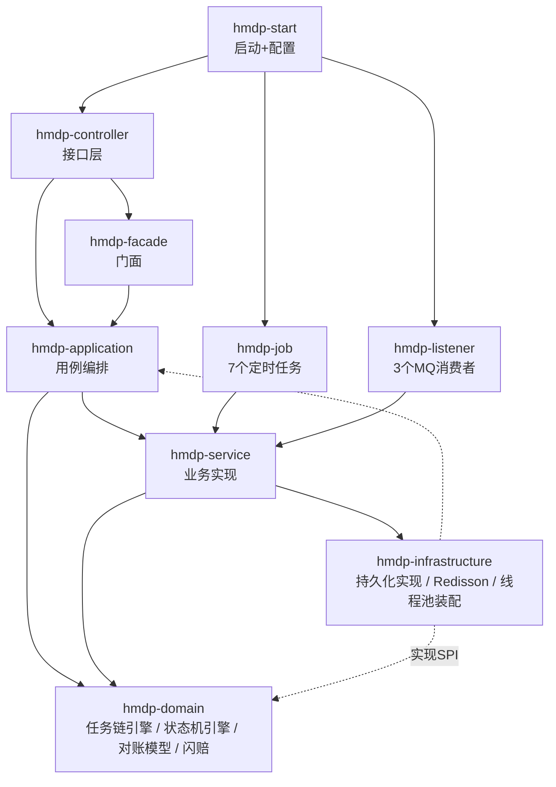
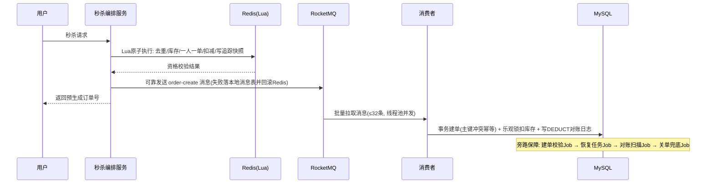

<p align="right"><b>简体中文</b> | <a href="./README_EN.md">English</a></p>

<div align="center">

# 🐴 hmdp-ultra — 黑马点评深度魔改版

一个基于**黑马点评**（大众点评类本地生活平台）的**深度魔改学习项目**


</div>

原版项目解决了"从 0 到 1"——秒杀、缓存、签到、附近的人。本仓库聚焦"**从 1 到 10**"：当系统变复杂之后——

- **架构怎么升级**：单模块三层 MVC → 多模块 DDD 分层（9 个 Maven 模块，依赖从外向内）
- **代码怎么不失控**：自研可编排任务链引擎与 CBB 状态机引擎，把编排逻辑从业务逻辑中彻底剥离
- **数据一致性怎么保证**：Redis 预扣 + RocketMQ 异步建单 + 本地消息表 / 建单校验 / 恢复任务 / 对账补偿的四级可靠性兜底
- **线上问题怎么排查**：7 类 JVM 故障注入开关 + JMeter 压测 + Prometheus 指标 + Arthas 定位闭环
- **技术栈怎么演进**：JDK 8 → 21、Spring Boot 2.3 → 3.2（jakarta 全量迁移），106 单测全绿 + VM 并行部署验证——[迁移实录](docs/MIGRATION-JDK21.md)

---

## ✨ 核心特性

### 🚀 秒杀 Plus — 全链路异步架构与一致性保障

- **Redis Lua 原子预扣**：请求去重、库存校验、一人一单、库存扣减、对账快照在单个 Lua 脚本内原子完成
- **RocketMQ 异步建单**：批量拉取（32 条）+ 自建线程池并发消费 + 手动确认，削峰填谷
- **消息可靠性治理**：同步发送 + 本地消息表兜底 + 定时重试；消费失败分级处理（异常捕获生成恢复任务 → 重放 → 人工审核，不依赖 MQ 整批重试）
- **超时关单**：延时消息触发 + 定时兜底扫描双保险，关单幂等回补库存
- **对账体系**：DEDUCT / RESTORE 对账日志（含库存前后快照）+ 订单域与库存域双向扫描 + 异常工单分级处置
- **入口限流**：滑动窗口限流（Redis ZSET + Lua 原子淘汰/计数/写入），按用户 1s/5 次可配可开关，超限直接 429
- **失败路径留痕**：Redis 回滚失败落 `tb_rollback_failure_log` + 告警标记，与对账扫描互补；本地消息表重试设有上限与 FAILED 终态
- **可观测性**：九个业务指标（重试耗尽 / 回滚失败 / 转人工 / 对账异常 / 限流拒绝 / 缓存命中率…）启动预注册并接入 Prometheus，压测收尾看"一致性体检表"（导学 Part 15.0）

### 🧩 可编排任务链引擎（自研）

- **五阶段流水线**：PRE_VALIDATION → PRE_PROCESSING（数据判断）→ DATA_PROCESSING → DATA_INSERTION → POST_PROCESSING，各阶段独立配置串行/并行
- **注解驱动**：`@TaskNode` 声明归属/顺序/线程池类型/可跳过语义，启动期构建不可变执行计划
- **CPU / IO 双线程池物理隔离**，避免互相饥饿
- **copy-merge 上下文并发模型**（参考 MVCC 多版本思想），解决并行节点写入竞争
- **落地场景**：商详页多数据源并行聚合、店铺评分刷新流水线

### ⚙️ CBB 通用自动化执行流水（状态机引擎，自研）

- **双层抽象**：引擎层零业务感知（payload 纯字符串），业务层只实现 StateNode
- **断点续传式持久化**：StateTask + StateTransitionLog 全部落库（SPI 扩展点，内存实现 / MyBatis 实现可切换）
- **失败策略分层**：FailurePolicy（业务层：该不该重试）+ RetryPolicy（引擎层：还剩几次），不可重试自动转人工
- **落地场景**：无忧闪赔赔付流程（SUBMITTED → APPROVED 算金额+调支付 → COMPLETED 查回执/写审计/发通知 / MANUAL_REVIEW）；支付、审计、通知均为 SPI 扩展点，支付以赔付单号为幂等键，失败统一转人工

### 🧠 多级缓存与失效广播

- **三级读取路径**：Caffeine 本地缓存（L1）→ Redis 逻辑过期（L2，复用 `CacheClient` 模板）→ MySQL；L1 存"已反序列化对象 + 真实逻辑过期时间"，命中也要校验过期
- **冷 key 回源**：L2 key 不存在时 `loadOnMiss` 互斥回源 DB，查到写逻辑过期结构、查不到写 2 分钟空值标记；update/评分刷新/冷启动不再依赖预热
- **写路径一致性**：先更库 → 本地 + Redis 双删 → RocketMQ **BROADCASTING** 广播失效（每实例必达）+ "从头消费"冷启动修正；广播失败由 L1 自身逻辑过期兜底
- **可回退**：`cache.local.enabled=false` 一键回到单级 Redis 链路（单级模板同样支持冷 key 回源）；命中率指标 `hmdp_cache_local_hits_total / misses_total` 接入 Prometheus

### 🧪 故障演练与压测闭环

<details>
<summary><b>7 类 JVM 故障注入开关、巡检流程与演练工具链</b>（点击展开）</summary>

- 7 类 JVM 故障注入开关：CPU 自旋、正则灾难性回溯、堆内存泄漏、ThreadLocal 泄漏、死锁、线程爆炸、大对象分配
- JVM 巡检流程：10 项基线巡检 + 死锁 / CPU 两场实战演练（`thread -b` 实锤死锁、jstack 火焰栈实锤热点），产出 HTML 报告
- JMeter 压测脚本（一键清库 / 同步库存 / 批量造 Token）+ Arthas 排查演练（dashboard / thread / jad / watch）

</details>

### 📊 五轮压测矩阵（实测归档）

| 轮次 | 变量 | 实测结果 |
|---|---|---|
| R1 基线 | 新版 · 4000 并发 / 3s 爬坡 | **4000/4000 全成、0 失败；Redis 与 MySQL 双侧完全一致、零超卖**；热机吞吐 154 req/s（Avg 51ms） |
| R2 对照 | 旧版 jar · 同参数 | 旧版 800 笔发送超时 → 回滚 + 本地消息表补发，暴露"回滚后订单仍被补建"语义冲突（字节码 + SQL 双证） |
| R3 限流 | 滑动窗口 · 开 / 关 | 开：同用户 12 并发 **5 过 7 拒**（429 + 指标 + 日志 + Redis 键四证）；关：0 拒；恢复后复测有效 |
| R4 缓存 | 多级缓存 L1 · 开 / 关 | 开：50 请求 **L1 命中 45、Redis 读流量省 90%**；关：每次请求打 Redis |
| R5 故障 | CPU 自旋注入 | 冷 JIT 单请求 **10–16s（约 775×）**，jstack 抓到 26 层火焰栈直指注入点 `fibonacciWarmup` |

> [!TIP]
> 原始数据（JTL / 日志 / 火焰栈 / 四份分析报告）见 [`dianping/stress-test`](dianping/stress-test)。

---

## 🏗️ 项目架构



> [!NOTE]
> domain 层不依赖任何外层模块，是整个项目可复用的核心；infrastructure 反向实现 domain 定义的 SPI 接口（依赖倒置）。

### 秒杀主链路



---

## 🧱 技术栈

| 层次 | 技术 |
|---|---|
| 运行时 | **JDK 21**（由 JDK 8 迁移，实录见 [docs/MIGRATION-JDK21.md](docs/MIGRATION-JDK21.md)） |
| 框架 | **Spring Boot 3.2**、Spring MVC、Spring AOP/事务 |
| 数据访问 | MyBatis-Plus 3.5（spring-boot3-starter）、MySQL 8（mysql-connector-j） |
| 缓存 | Redis（Lettuce 连接池）、Redisson、Caffeine（L1 本地缓存） |
| 消息队列 | RocketMQ（rocketmq-spring 2.3.1：同步发送、延时消息、批量消费） |
| 文档/工具 | Lombok、Hutool、Spring Boot Actuator + Prometheus |
| 质量 | JMeter 压测、Arthas 诊断、JUnit |

---

## 📂 项目结构

```
dianping
├── hmdp-start           # 启动模块 + 配置
├── hmdp-controller      # 接口层：Controller、拦截器、故障演练接口
├── hmdp-service         # 业务实现：秒杀Plus、评分刷新、原版功能
├── hmdp-domain          # 领域层：任务链引擎、状态机引擎、对账模型、闪赔状态机
├── hmdp-application     # 用例编排：商详聚合、超时关单
├── hmdp-facade          # 门面：统一对外业务 API
├── hmdp-infrastructure  # 基础设施：持久化实现、Redisson、引擎装配
├── hmdp-job             # 定时任务：重试/校验/恢复/对账/关单兜底/同步
└── hmdp-listener        # MQ 消费者：建单/超时关单/评分刷新
```

---

## 🚀 快速开始

### 环境依赖

- **JDK 21+**、Maven 3.6+（Boot 3.2 无法在 JDK 8 运行；迁移前的 JDK 8 版本见 git 历史）
- MySQL 8.x（库名 `dingping`，建表 SQL 见课程资料 `hmdp.sql`；闪赔审计表补丁见 `db/patch_payout_audit_log.sql`）
- Redis 5+（database 1）
- RocketMQ 4.9+（NameServer 默认 `127.0.0.1:9876`；本地无 MQ 时可启用 `MockRocketMQConfig` 的 Mock 生产者）

### 配置

`dianping/hmdp-start/src/main/resources/application.yaml` 支持环境变量覆盖：

| 变量 | 说明 | 默认值 |
|---|---|---|
| `DB_HOST` / `DB_PORT` / `DB_NAME` | MySQL 地址 | localhost / 3306 / dingping |
| `DB_USER` / `DB_PASSWORD` | 数据库账号 | root / 必填 |
| `REDIS_HOST` / `REDIS_PORT` / `REDIS_PASSWORD` | Redis 连接 | localhost / 6379 / 空 |
| `ROCKETMQ_NAMESRV` | NameServer 地址 | 127.0.0.1:9876 |

### 启动与验证

```bash
mvn -f dianping/pom.xml clean package -DskipTests
java -jar dianping/hmdp-start/target/*.jar
# 健康检查
curl http://localhost:8081/actuator/health
```

### 一键压测（可选）

`dianping/stress-test/` 提供完整工具链：`prepare_seckill_test.sh`（批量造用户 Token + 清库 + 同步库存）→ `run_seckill_test.sh`（JMeter 压测 + 指标报告，需先 `export MYSQL_PASS=<密码>`）。历史结果与五轮矩阵归档在 `results/`。

---

## 🔧 可观测与压测

- 指标端点：`GET /actuator/prometheus`（已暴露 health / info / prometheus）
- 故障注入：`POST /jvm/seckill-bug/{bug}/on|off`（7 类开关，`GET /jvm/seckill-bug/status` 查看状态）
- JVM 演练接口：`/jvm/cpu-loop`、`/jvm/deadlock`、`/jvm/full-gc` 等
- 压测：`stress-test/` 下提供 JMeter 脚本、准备与执行脚本、指标报告生成脚本

---

## ⚖️ 设计取舍（Known Trade-offs）

> [!NOTE]
> 本项目有意保留了一些**已被识别的取舍点**，用于展示工程决策过程：

<details>
<summary><b>1. 关单双路径的时序</b>（2026-10-17 已修复）</summary>

曾用延时档位 14（RocketMQ 默认 10 分钟），早于 15 分钟关单门槛导致延时消息白跑；现已把档位调到 15（20 分钟）：正常关单仍由每 2 分钟的兜底 Job 完成（约 16 分钟），延时消息只在兜底 Job 失效时作为最后备份生效。

</details>

<details>
<summary><b>2. 批量消费不向 MQ 回抛异常</b></summary>

单条失败由批量监听器捕获后直接写入 recovery_task（恢复任务重放兜底），另有建单校验与对账兜底，换取批处理吞吐；代价是主动放弃 MQ 层自动重试语义（重试语义上移到业务任务层）。

</details>

<details>
<summary><b>3. 对账自动补偿默认关闭</b></summary>

先观察异常模式再人工开启，避免补偿逻辑本身放大故障。

</details>

<details>
<summary><b>4. 发送失败语义冲突</b></summary>

"回滚 + 提示重试"与"本地消息表补发建单"两条路径并存：被回滚用户的订单仍可能被补发任务建出（唯一键保证不会重复建单，但提示语义冲突）。修复方向二选一：回滚时同步作废重试记录，或提示语改为"处理中"。

</details>

<details>
<summary><b>5. 对账体系以 DB 留痕为锚</b></summary>

"Redis 已动、DB 未留痕"的中间态对现有四级兜底不可见（故障演练中实弹暴露 4 例 Redis 预占残留）。改进方向：把预扣追踪日志纳入对账数据源。

</details>

---

## 🗺️ Roadmap

- [x] **JDK 21 / Spring Boot 3.2 迁移（2026-10-27）**：8→21 + Boot 2.3→3.2 + jakarta 全量迁移，106 单测全绿，VM 并行部署冒烟通过——迁移实录见 [docs/MIGRATION-JDK21.md](docs/MIGRATION-JDK21.md)
- [x] 五轮压测矩阵 + 三组开/关对照实验（限流 / 多级缓存 / 新旧版本）——结果归档 `dianping/stress-test/`
- [x] 修复建单校验重试耗尽后未转恢复任务的接线问题（2026-10-17：@Lazy 注入恢复服务，校验 FAILED 后正常转恢复）
- [x] 失败路径加固（2026-10-17）：发布成功后不回滚 Redis / 恢复与校验任务卡死回收 / 对账补偿 CAS 抢占 / 延时消息重发保档
- [x] 多级缓存读穿透与负缓存（2026-10-20）：冷 key 互斥回源 + 空值标记，删除缓存后不再依赖预热
- [ ] 对账数据源纳入 Redis 预扣追踪日志，覆盖"无 DB 留痕"漂移
- [ ] 接入虚拟线程（任务链 IO 池与消费池；JDK21 迁移已完成，只差开关与复测）
- [ ] Agent 评估体系（回答准确率/工具调用成功率）
- [ ] 多实例部署下的定时任务分布式调度（当前单机 `@Scheduled`）

---

## 🙏 致谢与声明

- 原始项目：**黑马点评**——黑马程序员课程项目，感谢原项目提供的"从 0 到 1"基础
- 深度魔改设计思路与教学：感谢课程作者 Knox 的架构设计与讲解
- 本仓库仅用于**个人学习与技术研究**，不用于任何商业用途；数据与压测结果均为本地实验环境产物
