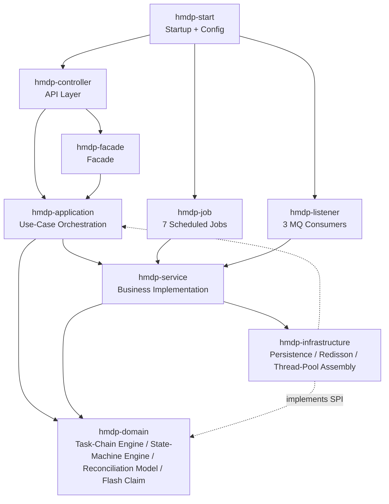
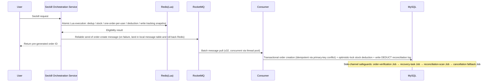

<p align="right"><a href="./README.md">简体中文</a> | <b>English</b></p>

<div align="center">

# 🐴 hmdp-ultra — Heima Dianping, Deeply Customized

A **deeply customized learning project** based on **Heima Dianping** (a Yelp-like local lifestyle platform)


</div>

The original project solved the "from 0 to 1" problem — seckill, caching, check-ins, and nearby users. This repository focuses on "**from 1 to 10**": what happens when the system grows complex —

- **How to upgrade the architecture**: single-module three-layer MVC → multi-module DDD layering (9 Maven modules, dependencies pointing inward)
- **How to keep the code under control**: a homegrown orchestratable task-chain engine and a CBB state-machine engine, completely separating orchestration logic from business logic
- **How to guarantee data consistency**: Redis pre-deduction + RocketMQ async order creation + a four-level reliability fallback of local message table / order-creation verification / recovery tasks / reconciliation compensation
- **How to troubleshoot production issues**: 7 types of JVM fault-injection switches + JMeter load testing + Prometheus metrics + an Arthas-based diagnosis loop

---

## ✨ Core Features

### 🚀 Seckill Plus — End-to-End Async Architecture with Consistency Guarantees

- **Atomic pre-deduction via Redis Lua**: request deduplication, stock validation, one-order-per-user, stock deduction, and reconciliation snapshot all completed atomically inside a single Lua script
- **Async order creation via RocketMQ**: batch pulling (32 messages) + dedicated thread pool for concurrent consumption + manual acknowledgement, flattening traffic peaks
- **Message reliability governance**: synchronous sending + local message table fallback + scheduled retries; tiered handling of consumption failures (exception capture generates a recovery task → replay → manual review, without relying on MQ whole-batch retries)
- **Order timeout cancellation**: delayed message triggering + scheduled fallback scanning as double insurance, with idempotent cancellation that restores stock
- **Reconciliation system**: DEDUCT / RESTORE reconciliation logs (with before/after stock snapshots) + bidirectional scanning of the order and stock domains + tiered handling of exception tickets
- **Entrance rate limiting**: sliding-window rate limiting (Redis ZSET + Lua for atomic eviction/counting/writes), configurable per user at 5 requests/s with an on/off switch; over-limit requests get an immediate 429
- **Failure-path tracing**: Redis rollback failures land in `tb_rollback_failure_log` + an alert flag, complementing reconciliation scans; local message table retries have an upper bound and a terminal FAILED state
- **Observability**: nine business metrics (retries exhausted / rollback failures / escalated-to-human / reconciliation anomalies / rate-limit rejections / cache hit ratio…) pre-registered at startup and wired into Prometheus; check the "consistency report card" at the end of load tests (tutorial Part 15.0)

### 🧩 Orchestratable Task-Chain Engine (Homegrown)

- **Five-stage pipeline**: PRE_VALIDATION → PRE_PROCESSING (data checks) → DATA_PROCESSING → DATA_INSERTION → POST_PROCESSING, each stage independently configurable as serial/parallel
- **Annotation-driven**: `@TaskNode` declares ownership/order/thread-pool type/skippable semantics; an immutable execution plan is built at startup
- **Physically isolated CPU / IO thread pools** to avoid mutual starvation
- **Copy-merge context concurrency model** (inspired by MVCC multi-versioning), resolving write contention among parallel nodes
- **Applied scenarios**: parallel aggregation of multiple data sources on the shop-detail page, shop rating refresh pipeline

### ⚙️ CBB General-Purpose Automation Execution Pipeline (State-Machine Engine, Homegrown)

- **Two-layer abstraction**: the engine layer has zero business awareness (payload is a plain string), while the business layer only implements StateNode
- **Checkpoint-resumable persistence**: StateTask + StateTransitionLog are fully persisted (SPI extension point; in-memory / MyBatis implementations are switchable)
- **Layered failure policies**: FailurePolicy (business layer: should we retry?) + RetryPolicy (engine layer: how many retries are left?); non-retryable failures escalate to human review automatically
- **Applied scenario**: worry-free flash-compensation claim flow (SUBMITTED → APPROVED → COMPLETED / MANUAL_REVIEW)

### 🧠 Multi-Level Cache and Invalidation Broadcast

- **Three-tier read path**: Caffeine local cache (L1) → Redis logical expiration (L2, reusing the `CacheClient` template) → MySQL; L1 stores "deserialized objects + real logical expiration time", and even cache hits verify expiration
- **Write-path consistency**: update DB first → double delete in local cache + Redis → RocketMQ **BROADCASTING** invalidation broadcast (guaranteed delivery to every instance) + "consume from the beginning" for cold-start correction; broadcast failures fall back to L1's own logical expiration
- **Reversible**: `cache.local.enabled=false` reverts to a single-tier Redis path in one switch; hit-ratio metrics `hmdp_cache_local_hits_total / misses_total` are wired into Prometheus

### 🧪 Fault Drills and Load-Test Loop

<details>
<summary><b>7 types of JVM fault-injection switches, inspection workflow, and drill toolchain</b> (click to expand)</summary>

- 7 types of JVM fault-injection switches: CPU spin, catastrophic regex backtracking, heap memory leak, ThreadLocal leak, deadlock, thread explosion, large-object allocation
- JVM inspection workflow: a 10-item baseline inspection + two hands-on drills (deadlock / CPU; `thread -b` to pin down deadlocks, jstack flame stacks to pin down hotspots), producing HTML reports
- JMeter load-test scripts (one-click DB cleanup / stock sync / batch token generation) + Arthas troubleshooting drills (dashboard / thread / jad / watch)

</details>

### 📊 Five-Round Load-Test Matrix (Measured and Archived)

| Round | Variable | Measured Result |
|---|---|---|
| R1 Baseline | New build · 4000 concurrent / 3s ramp | **4000/4000 orders created, 0 failures; Redis and MySQL fully consistent, zero overselling**; warm throughput 154 req/s (Avg 51ms) |
| R2 Comparison | Old jar · same parameters | 800 send timeouts on the old build → rollback + local-message-table re-send, exposing the "order rebuilt after rollback" semantic conflict (confirmed by both bytecode and SQL evidence) |
| R3 Rate Limit | Sliding window · on / off | On: 12 concurrent requests from the same user — **5 passed, 7 rejected** (429 + metrics + logs + Redis keys, four pieces of evidence); Off: 0 rejections; re-test after recovery still effective |
| R4 Cache | Multi-level cache L1 · on / off | On: 50 requests — **45 L1 hits, 90% less Redis read traffic**; Off: every request hits Redis |
| R5 Fault | CPU spin injection | Cold JIT: single request took **10–16s (~775×)**; jstack captured a 26-level flame stack pointing straight at the injection point `fibonacciWarmup` |

> [!TIP]
> Raw data (JTL / logs / flame stacks / four analysis reports) is in [`dianping/stress-test`](dianping/stress-test).

---

## 🏗️ Project Architecture



> [!NOTE]
> The domain layer depends on no outer modules and is the reusable core of the project; infrastructure implements the SPI interfaces defined by domain in reverse (dependency inversion).

### Seckill Main Flow



---

## 🧱 Tech Stack

| Layer | Technologies |
|---|---|
| Framework | Spring Boot, Spring MVC, Spring AOP/Transactions |
| Data Access | MyBatis-Plus, MySQL 8 |
| Caching | Redis (Lettuce connection pool), Redisson, Caffeine (L1 local cache) |
| Message Queue | RocketMQ (synchronous sending, delayed messages, batch consumption) |
| Docs/Tooling | Lombok, Hutool, Spring Boot Actuator + Prometheus |
| Quality | JMeter load testing, Arthas diagnostics, JUnit |

---

## 📂 Project Structure

```
dianping
├── hmdp-start           # Startup module + configuration
├── hmdp-controller      # API layer: controllers, interceptors, fault-drill endpoints
├── hmdp-service         # Business implementation: Seckill Plus, rating refresh, original features
├── hmdp-domain          # Domain layer: task-chain engine, state-machine engine, reconciliation model, flash-claim state machine
├── hmdp-application     # Use-case orchestration: shop-detail aggregation, timeout cancellation
├── hmdp-facade          # Facade: unified external business API
├── hmdp-infrastructure  # Infrastructure: persistence, Redisson, engine assembly
├── hmdp-job             # Scheduled jobs: retry / verification / recovery / reconciliation / cancellation fallback / sync
└── hmdp-listener        # MQ consumers: order creation / timeout cancellation / rating refresh
```

---

## 🚀 Quick Start

### Prerequisites

- JDK 8+, Maven 3.6+
- MySQL 8.x (database name `dingping`; table-creation SQL is `hmdp.sql` in the course materials)
- Redis 5+ (database 1)
- RocketMQ 4.9+ (NameServer defaults to `127.0.0.1:9876`; when running locally without MQ, you can enable the Mock producer in `MockRocketMQConfig`)

### Configuration

`dianping/hmdp-start/src/main/resources/application.yaml` supports environment-variable overrides:

| Variable | Description | Default |
|---|---|---|
| `DB_HOST` / `DB_PORT` / `DB_NAME` | MySQL address | localhost / 3306 / dingping |
| `DB_USER` / `DB_PASSWORD` | Database credentials | root / required |
| `REDIS_HOST` / `REDIS_PORT` / `REDIS_PASSWORD` | Redis connection | localhost / 6379 / empty |
| `ROCKETMQ_NAMESRV` | NameServer address | 127.0.0.1:9876 |

### Build, Run, and Verify

```bash
mvn -f dianping/pom.xml clean package -DskipTests
java -jar dianping/hmdp-start/target/*.jar
# Health check
curl http://localhost:8081/actuator/health
```

### One-Click Load Test (Optional)

`dianping/stress-test/` provides a complete toolchain: `prepare_seckill_test.sh` (batch token generation + DB cleanup + stock sync) → `run_seckill_test.sh` (JMeter load test + metrics report; run `export MYSQL_PASS=<password>` first). Historical results and the five-round matrix are archived in `results/`.

---

## 🔧 Observability and Load Testing

- Metrics endpoint: `GET /actuator/prometheus` (health / info / prometheus are exposed)
- Fault injection: `POST /jvm/seckill-bug/{bug}/on|off` (7 switches; `GET /jvm/seckill-bug/status` to view status)
- JVM drill endpoints: `/jvm/cpu-loop`, `/jvm/deadlock`, `/jvm/full-gc`, etc.
- Load testing: JMeter scripts plus preparation, execution, and metrics-report scripts under `stress-test/`

---

## ⚖️ Design Trade-offs (Known Trade-offs)

> [!NOTE]
> This project intentionally keeps several **identified trade-offs** on display, to show the engineering decision-making process:

<details>
<summary><b>1. Timing of the dual cancellation paths</b> (fixed on 2026-10-17)</summary>

The delayed-message level 14 (RocketMQ default 10 minutes) used to fire earlier than the 15-minute cancellation threshold, wasting the delayed message; the level is now set to 15 (20 minutes): normal cancellation is still handled by the fallback Job every 2 minutes (~16 minutes), and the delayed message only acts as a last-resort backup when the fallback Job fails.

</details>

<details>
<summary><b>2. Batch consumption does not rethrow exceptions to MQ</b></summary>

Single-message failures are caught by the batch listener and written directly to recovery_task (replayed by the recovery fallback), with order verification and reconciliation as additional fallbacks, in exchange for batch throughput; the cost is giving up MQ-level automatic retry semantics (retry semantics move up to the business task layer).

</details>

<details>
<summary><b>3. Automatic reconciliation compensation is off by default</b></summary>

Observe anomaly patterns first, then enable manually, avoiding the compensation logic itself amplifying the failure.

</details>

<details>
<summary><b>4. Send-failure semantic conflict</b></summary>

Two paths coexist: "rollback + prompt to retry" and "local-message-table re-send creating the order": the order of a rolled-back user may still be created by the re-send task (the unique key prevents duplicates, but the prompt semantics conflict). Two possible fixes: invalidate the retry record synchronously upon rollback, or change the prompt to "processing".

</details>

<details>
<summary><b>5. The reconciliation system is anchored on DB persistence</b></summary>

The intermediate state of "Redis touched, DB not yet recorded" is invisible to the current four-level fallback (4 real cases of residual Redis pre-holds were exposed during fault drills). Improvement direction: include pre-deduction tracking logs in the reconciliation data source.

</details>

---

## 🗺️ Roadmap

- [x] Five-round load-test matrix + three on/off comparison experiments (rate limiting / multi-level cache / new vs. old build) — results archived in `dianping/stress-test/`
- [x] Fixed the wiring issue where order-verification tasks did not escalate to recovery tasks after exhausting retries (2026-10-17: @Lazy injection of the recovery service; FAILED verifications now escalate normally)
- [x] Hardened failure paths (2026-10-17): no Redis rollback after successful publish / stuck recovery and verification tasks reaped / CAS preemption of reconciliation compensation / delayed-message resend preserves the level
- [ ] Include Redis pre-deduction tracking logs in the reconciliation data source, covering "no DB record" drift
- [ ] Adopt virtual threads (task-chain IO pool and consumption pool)
- [ ] Agent evaluation system (answer accuracy / tool-call success rate)
- [ ] Distributed scheduling of scheduled jobs under multi-instance deployment (currently single-node `@Scheduled`)

---

## 🙏 Acknowledgements & Disclaimer

- Original project: **Heima Dianping** — a course project by Heima Programmer; thanks to the original project for the "from 0 to 1" foundation
- Deep-customization design ideas and teaching: thanks to the course author Knox for the architecture design and explanations
- This repository is for **personal learning and technical research only**, not for any commercial use; all data and load-test results were produced in a local experimental environment
